## 👋 Hey everyone, I'm Alexandre 👋

Every day I spend my time creating new things, undertaking new projects that come to mind. I'm sure GitHub to share them, to show my work to others to inspire them or to learn new things through my code.
I am an alumni of Epitech and Keimyung University, so most of my projects are related to these schools but that doesn't stop me from adding my personal touch or making some of my own.
I'm looking forward to hearing your opinion about my projects and I hope you like them !

### Find me on these websites:

</a>

### Some fun facts about me:

- I love to play video games, especially on my Twitch channel (http://twitch.tv/AlexandreDFM)
- I love to do live coding on Twitch, sharing my knowledge and learning from others
- I love to create new things, whether it's a new project, a new feature, or a new way of doing things
- I love to learn new things, whether it's a new programming language, a new framework, or a new way of thinking

  
  

